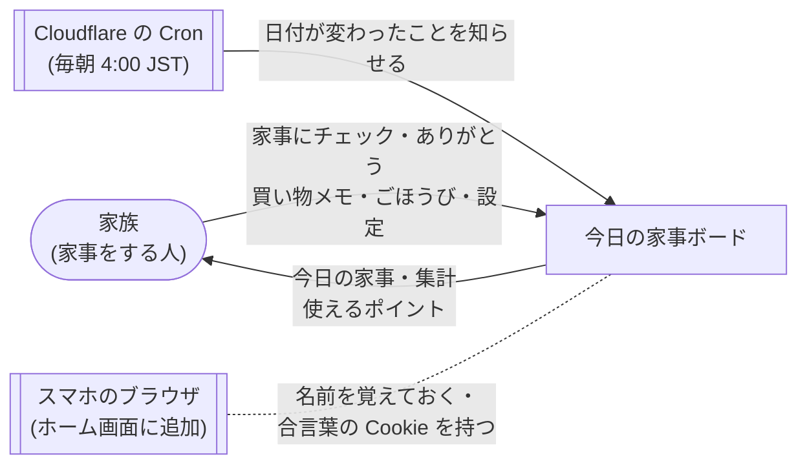
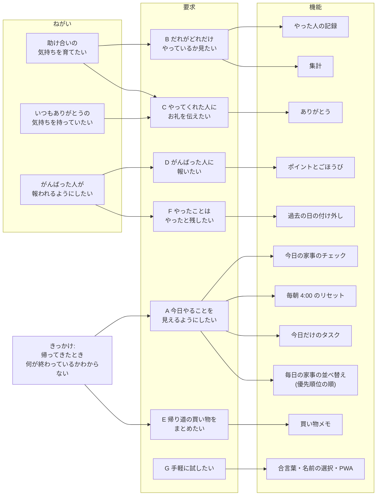

# 1. システム価値

「だれに、どんな価値を届けるか」の視点。ここが、ほかのすべての要素の「なぜ」になる。

> 1 周目。Claude の下書きを、本人との読み合わせで直した。

## システムコンテキスト

システムのまわりに、だれ(アクター)と、どんな外のシステムがいるか。

### アクター

| アクター | 説明 |
| --- | --- |
| 家族 | 家に住む一人ひとり。家事をする・ほかの人の家事にお礼を言う・欲しいものを書く・買ってくる・ポイントを使う。だれもが同じことをできる(管理者はいない) |

- 家族の中に役割の違いは無い(読み合わせで確かめた)。だれもが家事をし、お礼を言い、買い物を頼み、買ってくる。だからアクターは「家族」の 1 つにする
- ポイントを使ったご飯の代金は、家族の長が払う。ただし払うのはシステムの外の出来事で、システムの中では家族の長も、ほかの家族と同じ操作しかしない。だからアクターは分けず、[2](2-外部環境.md) のビジネスコンテキストに書く
  - RDRA の考え方: アクターを分けるのは、**システムとのかかわり方が違うとき**。暮らしの中の立場が違っても、システムへの操作が同じなら同じアクターでよい

### 外部システム

| 外部システム | 説明 |
| --- | --- |
| Cloudflare の Cron | 毎朝 4:00(JST)に動き、日付が変わっていればボードをリセットする |
| スマホのブラウザ | 選んだ名前(localStorage)と、合言葉を入れた印の Cookie を持つ。ホーム画面に追加して使う |

- スマホのブラウザは、ふつうの意味の「外部システム」ではないが、「だれか」をシステムの外で覚えているので、ここに置いた

## 要求モデル

家族の「こうしたい」(要求)と、それをかなえる機能のつながり。いちばん上に、家族として大事にしたいこと(ねがい)と、作るきっかけになった困りごとを置いた。
「なぜ」の列は、読み合わせで本人の言葉から書いた。

### ねがい(いちばん上の「なぜ」)

- **家族の中で、助け合いの気持ちを育てたい**
- **やってくれたことに、いつも「ありがとう」の気持ちを持っていたい**
- **がんばった人が報われる世界を、家族の中だけでも作りたい**

### きっかけ(困りごと)

仕事から帰ってきたとき、その日の家事のうち、何が終わっていて何が終わっていないかがわからない。だから、何から手をつければよいか見当がつかず、計画も立てにくい。

### 要求と機能

| 要求 | なぜ(本人の言葉から) | つながるねがい・きっかけ | かなえる機能 |
| --- | --- | --- | --- |
| A 今日やることを見えるようにしたい | 1 日の始まりにリセットされると、今日やるべきことが見える。前の日にやっても、次の日にはまた未着手に戻るのが家事だから。何から手をつけるかは、上から優先順位の順に並べておくことで決める | きっかけ | 今日の家事のチェック、毎朝 4:00 のリセット、今日だけのタスク、毎日の家事の並べ替え |
| B だれがどれだけやっているか見たい | 家族みんなで助け合って家事をこなしたい。数にすると、自分がどれだけがんばり、ほかの人がどれだけやってくれているかがわかる | 助け合い | やった人の記録、集計 |
| C やってくれた人にお礼を伝えたい | いやいややるのも、だれもやらないからだれかに負担がかかるのも違う。少しでも気持ちを伝えて「やってよかった」と思ってもらいたい。やれなかった人も「次は自分がやろう」と思えるように | 助け合い、ありがとう | ありがとう |
| D がんばった人に報いたい | がんばった人が報われる世界を作りたいから | 報われる | ポイントとごほうび |
| E 帰り道の買い物をまとめたい | 仕事帰りに、ついでに買って帰るのが効率がよい。前もって欲しいものがわかっていると、なおよい | きっかけ(仕事帰り) | 買い物メモ |
| F やったことはやったと残したい | やっていたのに付け忘れただけ、ということもある。さかのぼって、やったものはやったと記録したい。正しいかどうかは、本人の良心に任せる | 報われる | 過去の日の付け外し(7 日前まで) |
| G 手軽に試したい | まずはお試しなので、ログインは省いている(非機能の要求) | — | 合言葉、端末ごとの名前の選択、ホーム画面に追加 |

### まだかなえていない要求

| 要求 | なぜ | 今 |
| --- | --- | --- |
| 一人ひとりのアカウントでログインしたい | 本当はアカウントがあったほうがよい。お試しが終わったら作りたい | 機能は無い。G で代わりにしている |
| 管理する人は全員の記録を、一人ひとりは自分の成績を見たい | ふりかえりを、立場に合った形でしたい | アカウントが無いので見送り。今はだれもが同じ集計を見る |
| 息子にも家事に加わってほしい | 助け合いのねがいを、家族全員で | 機能は無い。今は夫婦の 2 人が中心 |

- 「管理する人」が現れると、アクターが「家族」と「管理する人」に分かれる。システムとのかかわり方(見られる範囲)が変わるから。アカウントの要求とセットで考える

- 要求 F の「本人の良心に任せる」は、[4](4-システム.md) の条件にも書く(さかのぼった記録をだれも確かめない、という決まり)

## つながり

| この視点の要素 | つながる先 |
| --- | --- |
| アクター「家族」 | [2](2-外部環境.md) のすべての BUC、[3](3-境界.md) のすべての UC |
| 外部システム「Cron」 | [3](3-境界.md) のイベント「毎朝 4:00」→ UC「ボードをリセットする」 |
| 外部システム「スマホのブラウザ」 | [3](3-境界.md) の UC「自分の名前を選ぶ」「合言葉を入れる」 |
| 要求 | [2](2-外部環境.md) の BUC(要求ごとに 1 つ以上) |
