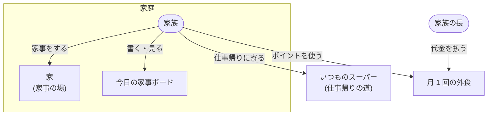
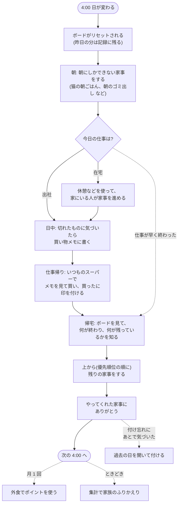

# 2. システム外部環境

「システムの外で、人はどう動いているか」の視点。システムは、この中のどこを手伝うのかを決める。

> 1 周目。Claude の下書きを、本人との読み合わせで直した。

## ビジネスコンテキスト

家庭という場に、だれと何があり、どうかかわっているか。

- ポイントを使うのは、月 1 回くらいの家族の外食のとき。代金は家族の長が払う(だれが払ってもよいが、家族の長が払うのがよいと決めている)。払うのはシステムの外なので、システムには「ポイントを使った」記録だけが残る
- 買い物に行く人は決まっていない。行ける人が買ってくる。今は、仕事帰りによく使うスーパーがある家族の長が、主に行っている
- 家事を主に回しているのは、今は夫婦の 2 人。息子にも加わってほしいが、まだできていない

## ビジネスユースケース(BUC)

業務「家のことを回す」を、目的ごとの BUC に分ける。BUC の中の「アクティビティ」は人の動き、その右が、そのとき使う UC([3](3-境界.md))。

### 業務: 家のことを回す

| BUC | アクティビティ | UC |
| --- | --- | --- |
| 使い始める | 家族の URL を開き、合言葉を入れる | 合言葉を入れる |
| | 自分の名前を選ぶ | 自分の名前を選ぶ |
| 毎日の家事を回す | 今日の家事を見る(何が終わっていて、何が残っているか) | 今日のボードを見る |
| | 上から順に、優先順位の高いものから手をつける | 今日のボードを見る(毎日の家事は優先順位の順に並ぶ) |
| | 終わった家事にチェックを入れる | 家事を完了にする |
| | まちがえたら戻す | 家事を未完了に戻す |
| | 代わりに付ける・一緒にやった人を付ける | やった人を選んで完了にする |
| | その日だけの用事を足す | 今日だけのタスクを足す |
| | 足しまちがえた用事を消す | 今日だけのタスクを消す |
| | 日が変わる(4:00) | ボードをリセットする |
| 家事の記録を直す | 昨日や数日前のボードを見る | 過去の日のボードを見る |
| | 付け忘れを付ける・外す | 過去の家事を完了にする / 未完了に戻す |
| 家事に報いる | やってくれた家事にお礼を言う | ありがとうを送る / 外す |
| | たまったポイントを見る | 使えるポイントを見る |
| | ご飯のときにポイントを使う | ポイントを使う |
| | 使いまちがえを戻す | ポイントの使用を取り消す |
| 買い物をまわす | 欲しいもの・切れたものを書く | 買い物の品を書く |
| | まちがえて書いたものを消す | 買い物の品を消す |
| | 買い物に行く前に見る | 買い物メモを見る |
| | 買ってきたら印を付ける | 品を買ったにする / 戻す |
| | ほかの人が買ってきた分を付ける | 買った人を選んで買ったにする |
| 家事をふりかえる | 期間を選んで、だれが何をどれだけやったか見る | 集計を見る |
| ボードを整える | 毎日の家事を足す・名前を変える・消す | 毎日の家事を足す / 名前を変える / 消す |
| | 優先順位が変わったら、並びを入れ替える | 毎日の家事を並べ替える |
| | 家族を足す・名前と色を変える・消す | 家族を足す / 変える / 消す |
| | 1 ポイントの円を決める | 1 ポイントの円を変える |
| | 試しに今すぐリセットする | ボードを手動でリセットする |

- 「家事をふりかえる」は、家族が自分たちでふりかえるため。今はだれもが同じ集計を見る。本当は、管理する人が全員の記録を見て、一人ひとりは自分の成績を見る形がよいかもしれないが、アカウントが無いので見送っている([1](1-システム価値.md) の「まだかなえていない要求」)
- 「何から手をつけるか」は、毎日の家事の並び順で決めている。上ほど優先順位が高く、変わったら並べ替える。つまり「毎日の家事を並べ替える」は、設定の作業に見えて、実は計画の手伝いになっている

## 業務フロー(1 日の流れ)

家事の 1 日は、JST 4:00 から次の 4:00 まで。

- 平日は出社が多いが、状況によって在宅で働く日もある。在宅の人は、休憩などを使って家事を進められる。仕事が早く終わった日は、帰ってすぐ残りの家事に取りかかる
- 家事の中には、**朝にやらないといけないもの**がある(猫の朝ごはん、朝のゴミ出し など)。今のボードには、家事の時間帯を表すものは無い(並び順で代わりにできる)

## 利用シーン

価値が生まれる具体的な場面。BUC を考えるときの手がかり。

| 利用シーン | BUC |
| --- | --- |
| 朝、出かける前に猫の朝ごはんをあげ、ゴミを出して、チェックを入れる | 毎日の家事を回す |
| 在宅の日、休憩のあいだに洗濯を干して、チェックを入れる | 毎日の家事を回す |
| 仕事から帰ってボードを開き、残っている家事を上から片づける | 毎日の家事を回す |
| 息子がお風呂掃除をしてくれた(今までに 3 回ほど、すべてお風呂掃除) | 毎日の家事を回す、家事に報いる |
| 冷蔵庫を開けたらケチャップが無かったので、メモに書く | 買い物をまわす |
| 仕事帰りにいつものスーパーでメモを見て、ほかの家族の欲しいものも一緒に買う | 買い物をまわす |
| やってくれた家事に「ありがとう」を送る | 家事に報いる |
| 月 1 回の外食で、たまったポイントを使う | 家事に報いる |
| 昨日ゴミ出しのチェックを忘れていたので、あとから付ける | 家事の記録を直す |
| 家族で、だれが何をどれだけやったかをふりかえる | 家事をふりかえる |

- 息子がやるのは、楽な家事が中心。今のポイントは家事 1 回で 1 ポイントなので、楽な家事も大変な家事も同じポイントになる(要求 D「がんばった人に報いたい」とのつながりは、2 周目で見直す)

## つながり

| この視点の要素 | つながる先 |
| --- | --- |
| BUC のアクティビティ | 右の列の UC([3](3-境界.md)) |
| 業務フローの「4:00 日が変わる」 | [3](3-境界.md) のイベント「毎朝 4:00」、[4](4-システム.md) の条件「家事の日付は JST 4:00 で区切る」 |
| BUC | [1](1-システム価値.md) の要求(使い始める・ボードを整える ← 手軽に使いたい、など) |
