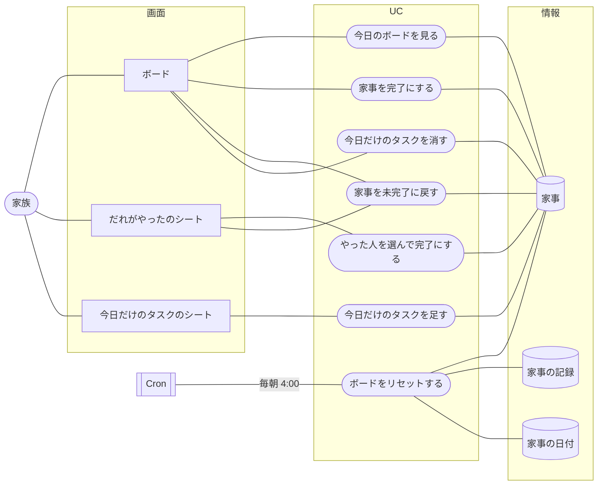
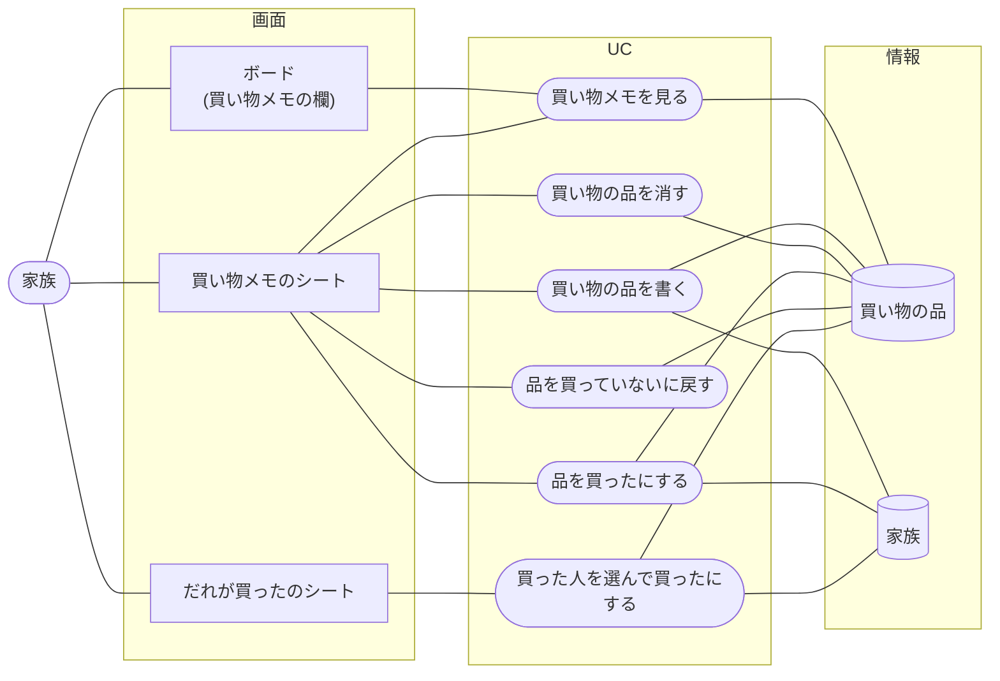
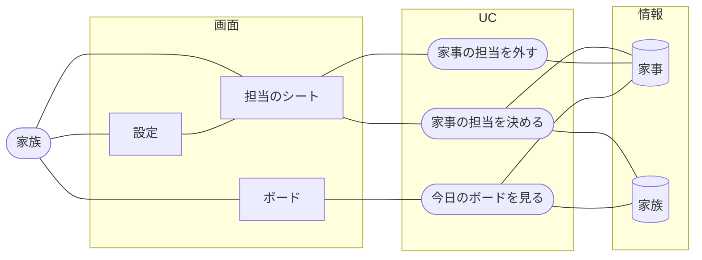
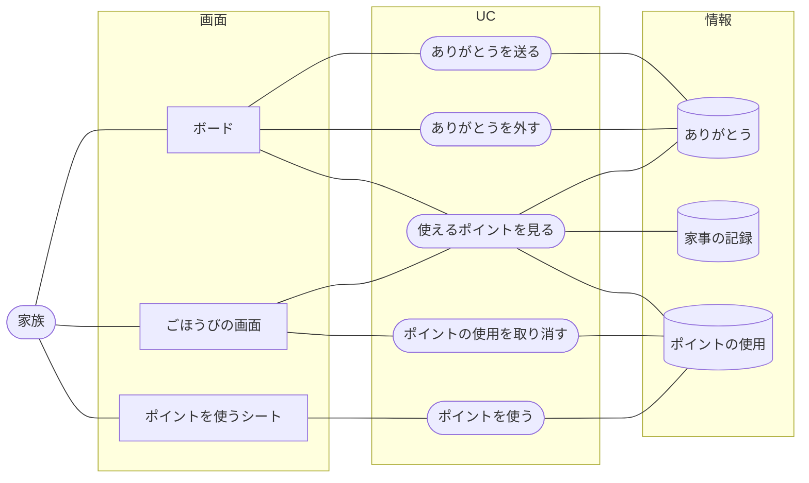

# 3. システム境界

「人とシステムはどこで接するか」の視点。UC(ユースケース)ごとに、使う画面と、きっかけになるイベントをつなぐ。
今のシステムから起こしたので、ここはコードと照らし合わせて確かめられる。

## 画面

画面(ページ)と、その上に開くシート。UC はこの一覧から起こした。

| 画面 | ファイル | 中身 |
| --- | --- | --- |
| 合言葉の画面 | `public/index.html` `#login` | 合言葉を入れて「はじめる」 |
| ボード | `public/index.html` `#board` | 今日(または過去の日)の家事、進み具合、買い物メモの欄、名前とポイント、‹ ›、＋ |
| 今日だけのタスクのシート | `#add-dialog` | 今日だけのタスクを書いて足す |
| 名前のシート | `#me-dialog` | 自分の名前を選ぶ。家族を足す |
| だれがやったのシート | `#who-dialog` | やった人を選んで完了にする・未完了に戻す |
| 買い物メモのシート | `#shop-dialog` | 品の一覧、○(買った)、×(消す)、書く欄 |
| だれが買ったのシート | `#buyer-dialog` | 買った人を選ぶ |
| 担当のシート | `#owner-dialog` | 毎日の家事の担当を選ぶ・外す |
| 設定 | `#edit-dialog` | 毎日の家事、毎日の家事の担当、家族と色、1 ポイントの円、集計・ごほうびへの入口、今すぐリセット |
| 集計の画面 | `public/stats.html` | 7 日・30 日・ぜんぶ、完了の割合、日ごと・月ごと、だれが、家事ごと |
| ごほうびの画面 | `public/rewards.html` | 家族ごとの使えるポイント、使った記録 |
| ポイントを使うシート | `rewards.html` `#use-dialog` | 使うポイントを入れる |

## イベント

人の操作ではなく、時間や外のシステムがきっかけになるもの。

| イベント | 送り元 | UC |
| --- | --- | --- |
| 毎朝 4:00(JST)になった | Cloudflare の Cron | ボードをリセットする |
| その日の最初のアクセス | (家族のだれかが開く) | ボードをリセットする(Cron が動かなかった日の追いつき) |
| 20 秒たった・開き直した | スマホのブラウザ | 今日のボードを見る(ほかの家族の操作を映す) |
| 買った日の次の朝 4 時を過ぎた | (時刻) | 買い物メモを見る(買った品が一覧から消える。2 周目で足した) |

## UC 複合図

主な BUC について、アクター・UC・画面・イベント・情報のつながりを図にした。全部の UC は、あとの「UC の一覧」の表にある。

### 毎日の家事を回す

### 買い物をまわす

### 家事を任せる

### 家事に報いる

## UC の一覧

UC 名は「〜を〜する」の形。API は `src/index.ts` のルート。情報は [4](4-システム.md) の情報モデルの名前。

| BUC | UC | 画面 / イベント | API | 情報 |
| --- | --- | --- | --- | --- |
| 使い始める | 合言葉を入れる | 合言葉の画面 | `POST /api/login` | (なし) |
| | 自分の名前を選ぶ | 名前のシート | (なし。端末に覚える) | 家族 |
| 毎日の家事を回す | 今日のボードを見る | ボード / 20 秒ごと | `GET /api/board` | 家事、家族、買い物の品、ポイント(数える) |
| | 家事を完了にする | ボード(タップ) | `POST /api/tasks/:id/check` | 家事 |
| | 家事を未完了に戻す | ボード(もう一度タップ・元に戻す)、だれがやったのシート | `POST /api/tasks/:id/uncheck` | 家事、ありがとう |
| | やった人を選んで完了にする | だれがやったのシート(長押し) | `POST /api/tasks/:id/check`(reassign) | 家事、家族、ありがとう |
| | 今日だけのタスクを足す | 今日だけのタスクのシート(＋) | `POST /api/tasks`(once) | 家事 |
| | 今日だけのタスクを消す | ボード | `DELETE /api/tasks/:id` | 家事 |
| | ボードをリセットする | 毎朝 4:00 / その日の最初のアクセス | (Cron の `scheduled`、各 API の前の日付の確かめ) | 家事、家事の記録、家事の日付 |
| 家事の記録を直す | 過去の日のボードを見る | ボード(‹ ›) | `GET /api/history/:date` | 家事の記録 |
| | 過去の家事を完了にする | ボード・だれがやったのシート(過去の日) | `POST /api/history/:id/check` | 家事の記録 |
| | 過去の家事を未完了に戻す | ボード(過去の日) | `POST /api/history/:id/uncheck` | 家事の記録、ありがとう |
| 家事を任せる | 家事の担当を決める | 設定(担当のシート) | `POST /api/tasks/:id/owner` | 家事、家族 |
| | 家事の担当を外す | 設定(担当のシートの「なし」) | `DELETE /api/tasks/:id/owner` | 家事 |
| 家事に報いる | ありがとうを送る / 外す | ボード | `POST /api/tasks/:id/thanks`、`POST /api/history/:id/thanks` | ありがとう |
| | 使えるポイントを見る | ボード(名前の下)、ごほうびの画面 | `GET /api/board`、`GET /api/rewards` | 家事の記録、ありがとう、ポイントの使用 |
| | ポイントを使う | ポイントを使うシート | `POST /api/rewards/uses` | ポイントの使用 |
| | ポイントの使用を取り消す | ごほうびの画面 | `POST /api/rewards/uses/:id/cancel` | ポイントの使用 |
| 買い物をまわす | 買い物メモを見る | ボード(欄)、買い物メモのシート | `GET /api/board` | 買い物の品 |
| | 買い物の品を書く | 買い物メモのシート | `POST /api/shopping` | 買い物の品 |
| | 買い物の品を消す | 買い物メモのシート(×) | `DELETE /api/shopping/:id` | 買い物の品 |
| | 品を買ったにする | 買い物メモのシート(○) | `POST /api/shopping/:id/buy` | 買い物の品 |
| | 品を買っていないに戻す | 買い物メモのシート(○) | `POST /api/shopping/:id/unbuy` | 買い物の品 |
| | 買った人を選んで買ったにする | だれが買ったのシート(長押し) | `POST /api/shopping/:id/buy`(reassign) | 買い物の品、家族 |
| 家事をふりかえる | 集計を見る | 集計の画面 | `GET /api/stats` | 家事の記録、家族 |
| ボードを整える | 毎日の家事を足す | 設定 | `POST /api/tasks`(daily) | 家事 |
| | 毎日の家事の名前を変える | 設定 | `PATCH /api/tasks/:id` | 家事 |
| | 毎日の家事を消す | 設定 | `DELETE /api/tasks/:id` | 家事 |
| | 毎日の家事を並べ替える | 設定(↑↓) | `POST /api/tasks/reorder` | 家事 |
| | 家族を足す | 設定、名前のシート | `POST /api/members` | 家族 |
| | 家族の名前・色を変える | 設定 | `PATCH /api/members/:id` | 家族 |
| | 家族を消す | 設定 | `DELETE /api/members/:id` | 家族、家事(担当が外れる) |
| | 1 ポイントの円を変える | 設定 | `PATCH /api/settings` | ポイントの決まり |
| | ボードを手動でリセットする | 設定(今すぐリセット) | `POST /api/reset` | 家事、家事の日付 |

- API 28 本のすべてが、どれかの UC につながっている(下から起こした索引と、上から起こした UC が合った)
- 「自分の名前を選ぶ」だけは API が無い。名前は端末にだけ覚える

## つながり

| この視点の要素 | つながる先 |
| --- | --- |
| UC | 左の列の BUC([2](2-外部環境.md))、右の列の情報([4](4-システム.md)) |
| UC のうち、状態を変えるもの | [4](4-システム.md) の状態モデルの遷移 |
| イベント「毎朝 4:00」 | [1](1-システム価値.md) の外部システム「Cron」、[4](4-システム.md) の条件「4:00 区切り」 |
