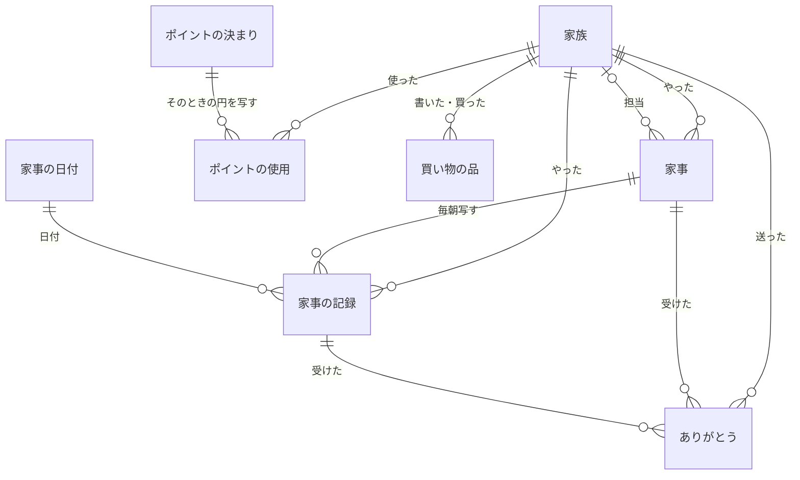
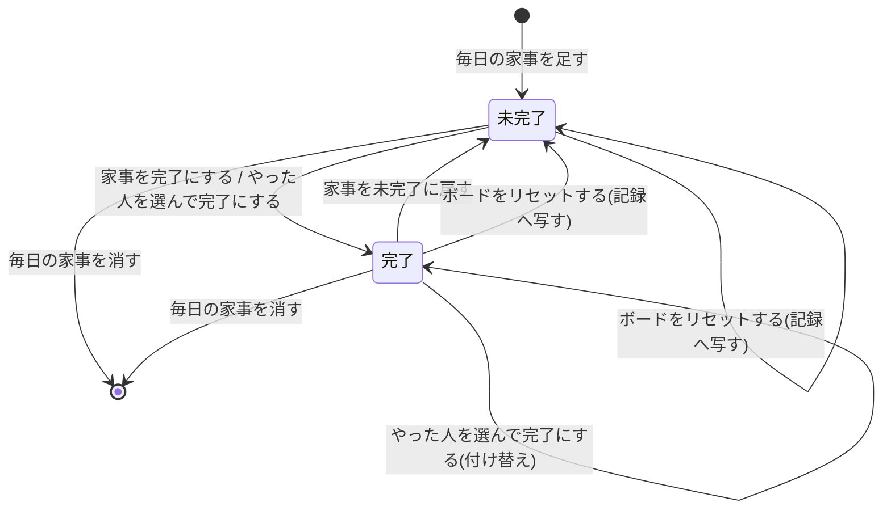
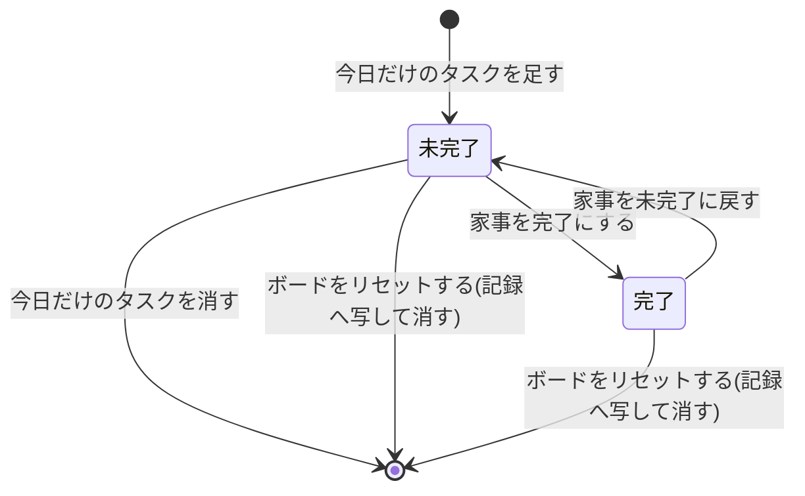
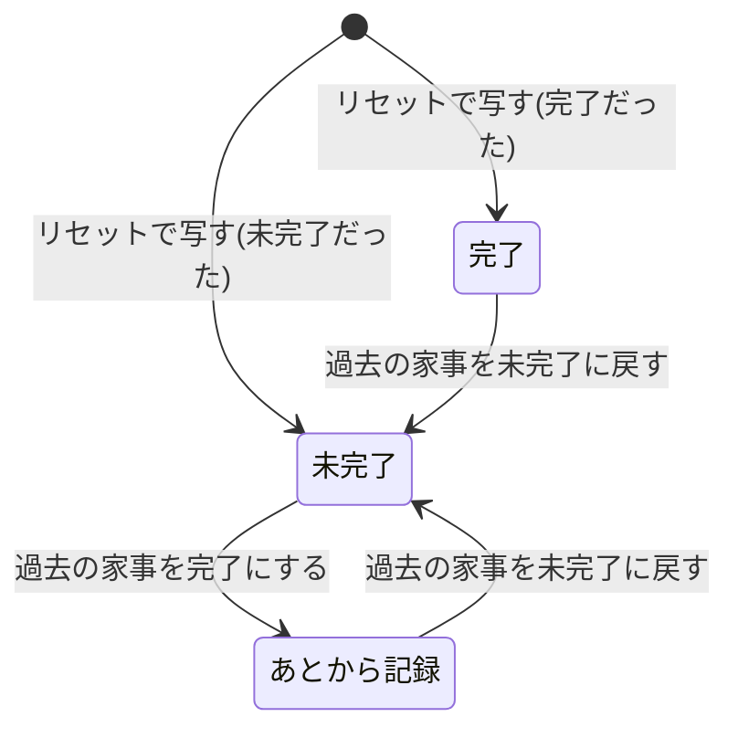
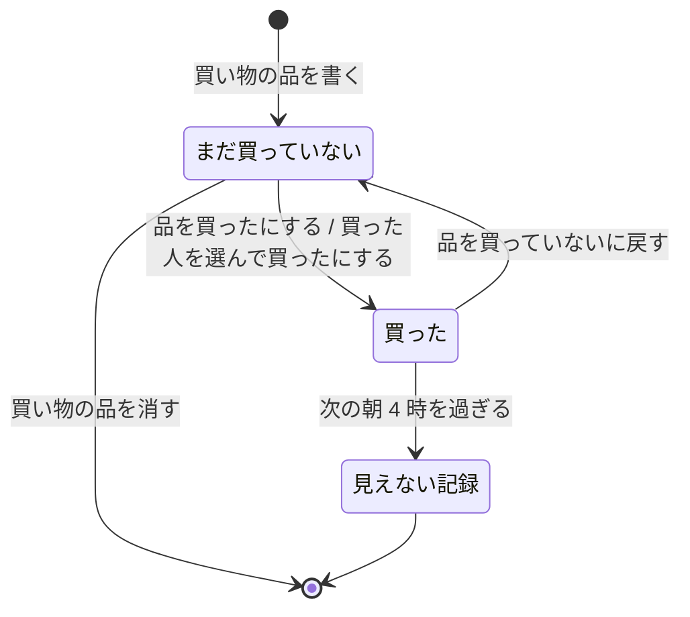
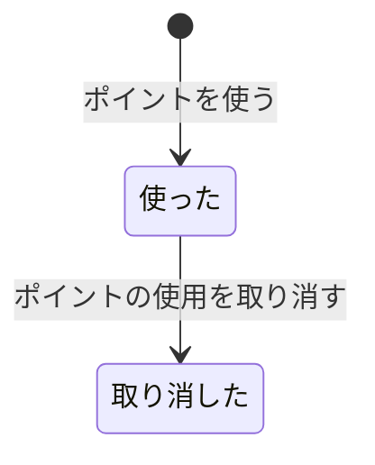

# 4. システム

「システムは何を覚え、どう変わるか」の視点。情報・状態・条件・バリエーションを並べる。
今のシステムから起こしたので、ここは `migrations/` と `src/index.ts` と照らし合わせて確かめられる。

## 情報モデル

テーブルをそのまま並べず、**家族が業務で扱う単位**にまとめた。右の列が、その情報を持っているテーブル。

| 情報 | 説明 | テーブル |
| --- | --- | --- |
| 家族 | 名前・色・並び | `members` |
| 家事 | 今日のボードに並ぶ家事。やった人と、毎日の家事の担当(家族 0〜1 人)も含む | `tasks`(担当は `owner_id`)、`task_doers` |
| 家事の記録 | 終わった日の家事と、やった人。消さずにためる。担当は写さない | `history`、`history_doers` |
| ありがとう | 完了した家事へのお礼。今日の分と記録の分がある | `task_thanks`、`history_thanks` |
| ポイントの使用 | 使ったポイントと、そのときの 1 ポイントの円。取り消しの印 | `point_uses` |
| 買い物の品 | 書いた品と、買ったかどうか。買った行は消さずにためる | `shopping_items` |
| 家事の日付 | 今のボードが何日の分か | `meta`(`board_date`) |
| ポイントの決まり | 1 ポイントが何円か | `meta`(`yen_per_point`) |

- **ポイント(ためた分・使える分)は情報として持っていない**。家事の記録とありがとうから毎回数え、ポイントの使用を引く。RDRA の上では「家事の記録・ありがとう・ポイントの使用から求めるもの」になる

- 家族を消しても、家事の記録・ありがとうの記録・ポイントの使用・買い物の品には名前が写してあるので残る。家事の担当は外れる(「担当なし」になる)

## 状態モデル

状態が変わるものと、変えるきっかけの UC([3](3-境界.md))。

- 家事の担当は状態にしない。担当の有無で、できる UC が変わらないため(担当でない人も完了にできる)。家事の持つ情報にする

### 家事(毎日の家事)

### 家事(今日だけのタスク)

### 家事の記録

- 「あとから記録」は、その日が終わってから付けたもの(画面に「あとから記録」と出る)。データの上では完了と同じで、付けた時刻で見分ける

### 買い物の品

- 「見えない記録」は、行は残っているが、画面には出ない状態。消さずにためる

### ポイントの使用

## バリエーション

種類による違い。

| バリエーション | 値 | 何が変わるか |
| --- | --- | --- |
| 家事の種類 | 毎日の家事 / 今日だけのタスク | リセットで、毎日の家事は未完了に戻り、今日だけのタスクは消える。設定で触れるのは毎日の家事だけ。担当を付けられるのは毎日の家事だけ |
| 見ている日 | 今日 / 過去の日(昨日〜7 日前) | 過去の日は家事の記録を見る。＋と買い物メモは出ない |
| 集計の期間 | 7 日 / 30 日 / ぜんぶ | 長い期間は月ごとに数える |
| 家族の色 | 6 色 | ボードと集計で、だれかを見分ける |

## 条件

家族にとっての決まり(仕組みのためのルールは入れない)。かかわる UC と、かかわるバリエーション・状態も書く。

| 条件 | 中身 | かかわる UC | かかわるバリエーション・状態 |
| --- | --- | --- | --- |
| 家事の日付の区切り | JST 4:00 で日が変わる | ボードをリセットする、品を買ったにする、ポイントを使う | 家事・買い物の品の状態 |
| 過去の日の範囲 | 昨日〜7 日前まで見られ、付け外しできる | 過去の日のボードを見る、過去の家事を完了にする | 見ている日 |
| あとから付けた記録の扱い | さかのぼって付けた記録も、ほかの記録と同じに数える。正しいかはだれも確かめず、本人の良心に任せる | 過去の家事を完了にする、使えるポイントを見る、集計を見る | 家事の記録の状態 |
| 完了の決まり | タップは自分 1 人で完了。長押しで何人でも選べる。先にだれかが完了にしていたら、タップでは変えない | 家事を完了にする、やった人を選んで完了にする | 家事の状態 |
| ありがとうの決まり | 完了していて、やった人がいる家事に、やった人以外が送れる。1 つの家事に 1 人 1 回 | ありがとうを送る | 家事・家事の記録の状態 |
| ありがとうが消えるとき | やった人に入った人の分と、未完了に戻したときは消える | 家事を未完了に戻す、やった人を選んで完了にする | 家事の状態 |
| ポイントの数え方 | 家事 1 回で 1 ポイント、もらったありがとう 1 つで 1 ポイント。使える = ためた − 使った(取り消し分は除く)。担当の家事も同じ | 使えるポイントを見る | ポイントの使用の状態 |
| ポイントの使い方 | 使えるポイントより多くは使えない。1 以上の整数 | ポイントを使う | — |
| 1 ポイントの円 | はじめは 10 円。1〜1,000 円で変えられる。使ったときの円を記録に写す | 1 ポイントの円を変える、ポイントを使う | — |
| 買い物の品の決まり | まだ買っていない品の中で、同じ品名は 1 つまで(全角・半角などをそろえて比べる)、50 件まで | 買い物の品を書く | 買い物の品の状態 |
| 買った品が見えなくなるとき | 買った日の次の 4:00 を過ぎたら、一覧から消える(記録は残る) | 買い物メモを見る | 買い物の品の状態 |
| 担当は目印 | 担当の人でなくても、だれでも完了にできる。ポイントはやった人に入る | 家事を完了にする、やった人を選んで完了にする | 家事の状態 |
| 担当の数 | 1 つの毎日の家事に、担当は 0〜1 人 | 家事の担当を決める | 家事の種類 |
| 家族を消したとき(担当) | その人が担当だった家事は「担当なし」になる | 家族を消す | — |
| 担当が外れるとき | リセット(毎朝・今すぐ)では外れない。外れるのは、担当を「なし」にしたとき・その家族を消したとき・その家事を消したときだけ | 家事の担当を外す、家族を消す、毎日の家事を消す、ボードをリセットする | — |
| 名前の長さ | 家事は 1〜40 文字、家族は 1〜12 文字 | 毎日の家事を足す、今日だけのタスクを足す、家族を足す | — |

## つながり

| この視点の要素 | つながる先 |
| --- | --- |
| 情報 | それを読み書きする UC([3](3-境界.md) の「UC の一覧」の右の列) |
| 状態の遷移 | 遷移のきっかけの UC([3](3-境界.md)) |
| 条件「家事の日付の区切り」 | [2](2-外部環境.md) の業務フロー、[3](3-境界.md) のイベント「毎朝 4:00」 |
| 情報「家事の記録」(消さずにためる) | [1](1-システム価値.md) の要求「だれがどれだけやっているか見たい」 |
