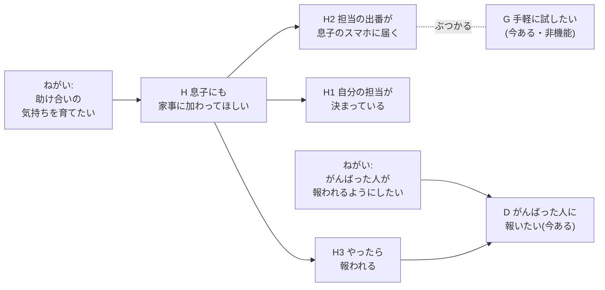
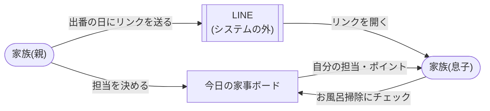
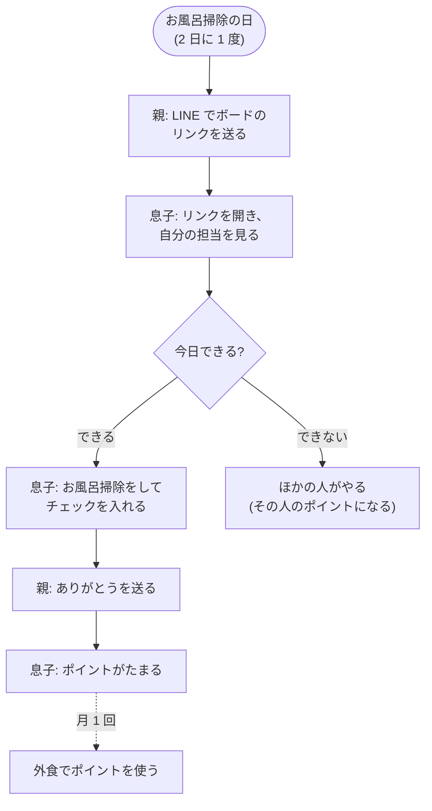
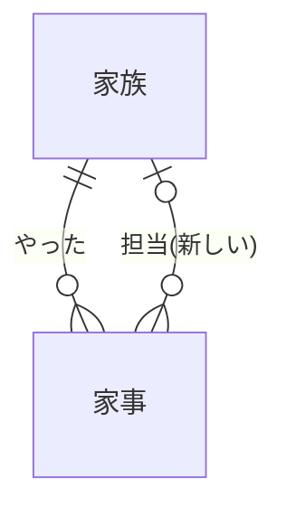

# 6. 要件定義: 息子が家事に加わるきっかけ(#35)

Issue: #35

1〜5 は、できあがっているシステムを内側から起こした(既存システムの可視化)。
ここでは逆に、**新しい要求を外側から内側へ下ろす**(RDRA 本来の要件定義の進め方)。前回の地図に何が足されるかを、視点ごとの差分で書く。

> 1 周目。本人への聞き取り(2026-11-22)から書いた。

## 進め方

1. **今の姿(As-Is)** を、本人の言葉で外部環境に書く
2. **ありたい姿(To-Be)** を決め、要求を細かくする
3. To-Be の業務を BUC に書き、その中で**システムが手伝う所だけ**を UC にする
4. UC から、情報・状態・条件・バリエーションの差分を出す
5. 要求どうしのぶつかりと、決めたことを残す

## 1. 今の姿(As-Is)

| 聞いたこと | 答え |
| --- | --- |
| お風呂掃除をした 3 回のきっかけ | 自分からやった |
| 家事をしない理由 | 何をすればいいか知らない、やり方を知らない、やる気が起きない |
| ボードを見ているか | ほぼ見ていない |
| いちばん届く伝え方 | LINE などのメッセージ |
| やる気に効きそうなもの | ポイント・ごほうび、自分の担当があること |

- **息子は、システムとつながっていない**。アクター「家族」の一人のはずが、システムコンテキストの線が実際には引かれていない。だから、ボードの中に UC を足しても届かない
- やる気がゼロなのではない。「何を・どうやって」が分かっている家事(お風呂掃除)なら、自分から動けている

## 2. 価値の層の差分

### 要求

「まだかなえていない要求」にあった「息子にも家事に加わってほしい」を、要求 H として上げ、もう 1 段細かくする。

| 要求 | なぜ(本人の言葉から) | まず目指す姿 |
| --- | --- | --- |
| H1 自分の担当が決まっている | 「何をすればいいか知らない」をなくす。担当があるとやる気が出る | お風呂掃除を息子の担当にする |
| H2 担当の出番が、息子のスマホに届く | ボードはほぼ見ていないが、LINE なら届く | お風呂掃除の日(2 日に 1 度)に、LINE でボードへのリンクが届く |
| H3 やったら報われる | ポイント・ごほうびが効く | 今のポイント(家事 1 回で 1 ポイント)を、そのまま息子にもためる |

- 「やり方を知らない」には、今回は手を付けない。まずはやり方を知っているお風呂掃除で習慣を作り、そのあとで家事を増やす

### システムコンテキスト

- アクターは「家族」のまま分けない。担当があってもなくても、システムへの操作は同じだから(1 のアクターの決め方と同じ考え)
- **LINE は、お試しのあいだ外部システムにしない**。親が手で送るので、システムとは直接つながらない。RDRA では「業務フローにはあるが、UC にはならない動き」になる

## 3. 外部環境の層の差分

### BUC「家事を任せる」(新しい)

業務「家のことを回す」に、BUC を 1 つ足す。

| アクティビティ | だれが | UC |
| --- | --- | --- |
| 息子のスマホで、合言葉を入れて名前を選び、ホーム画面に追加する(はじめの 1 回) | 親と息子 | 合言葉を入れる、自分の名前を選ぶ(今ある) |
| お風呂掃除を、息子の担当にする | 親 | **家事の担当を決める**(新しい) |
| お風呂掃除の日に、LINE でボードのリンクを送る | 親 | (システムの外) |
| リンクを開き、自分の担当を見る | 息子 | 今日のボードを見る(担当が出る) |
| お風呂掃除をして、チェックを入れる | 息子 | 家事を完了にする(今ある) |
| やってくれたことにお礼を言う | 親 | ありがとうを送る(今ある) |
| たまったポイントを見る | 息子 | 使えるポイントを見る(今ある) |
| 担当を外す・ほかの人にする | 親 | **家事の担当を外す**(新しい) |

### 業務フロー(お風呂掃除の日)

## 4. 境界の層の差分

| UC | 新しい・変わる | 画面とイベント |
| --- | --- | --- |
| 家事の担当を決める | 新しい | 設定で、毎日の家事ごとに担当の家族を 1 人選ぶ |
| 家事の担当を外す | 新しい | 設定で、担当を「なし」にする |
| 今日のボードを見る | 変わる | 担当のある家事に、担当の名前を出す。選んでいる名前が担当なら、目立たせる |

- 新しいイベントは無い。知らせるのは親の手で、Cron は使わない

## 5. システムの層の差分

### 情報

| 情報 | 差分 |
| --- | --- |
| 家事 | 「担当」(家族、0〜1 人)を持つ。毎日の家事だけ |
| 家事の記録 | 変えない。担当は記録に写さない(下の「測り方」は、やった人から数えられる) |

### 状態

- **変えない**。担当は家事の状態ではなく、家事の持つ情報。担当があってもなくても、家事は「未完了 → 完了」と同じに動く
  - RDRA の考え方: 状態にするのは、**それによって、できる UC が変わるもの**。担当の有無で完了にできる人は変わらない(下の条件)ので、状態にしない

### 条件

| 条件 | 中身 | かかわる UC |
| --- | --- | --- |
| 担当は目印 | 担当の人でなくても、だれでも完了にできる。やった人のポイントになる | 家事を完了にする、やった人を選んで完了にする |
| 担当の数 | 1 つの家事に、担当は 0〜1 人 | 家事の担当を決める |
| 家族を消したとき | 担当だった家事は「担当なし」になる | 家族を消す |
| ポイントの数え方 | 変えない(家事 1 回で 1 ポイント)。担当の家事も同じ | 使えるポイントを見る |

### バリエーション

- 変えない

## 6. 決めたこと・ぶつかり

| # | ぶつかり | 決めたこと | 理由 |
| --- | --- | --- | --- |
| 1 | H2「スマホに届く」と G「手軽に試したい」。自動で LINE に送るには、LINE 公式アカウントと Messaging API の準備が要る | お試しの 1〜2 週間は、親が手で送る。システムは担当を表すだけ | 先に、息子の行動が変わるかを確かめる。効いたら自動にする(下の「次に考えること」) |
| 2 | H3・D「報われる」と、ねがい「助け合い」(楽な家事でも入りやすく)。気づき C-9 の家事の重さ | 今回は 1 ポイントのまま | 楽な家事から入りやすいほうを取る。息子が定着してから重さを考え直す |
| 3 | 担当の日にやれなかったとき | だれがやってもよい。担当は目印 | 家事が止まるほうが困る。今の完了の仕組みを変えずに済む |

## 7. 測り方(終わりの条件)

- #35 の終わりの条件は「作ったかではなく、息子の行動が変わったか」
- 情報「家事の記録」のやった人から、**息子がお風呂掃除をした回数**を数えられる。新しい情報は要らない
- 目安: 1〜2 週間で、お風呂掃除の日(5〜7 回)のうち、息子がやった回数。今までは数か月で 3 回ほど

## 8. 気づき(この要件定義で見つけたこと)

| # | 気づき | どこのすきまか | 扱い |
| --- | --- | --- | --- |
| 13 | **「2 日に 1 度」の家事を表せない**。家事の種類は「毎日」と「今日だけ」の 2 つしかない | バリエーション「家事の種類」に、頻度が無い。今のお風呂掃除が、ボードでどう扱われているかを確かめる | 今回は親が手で送るので、システムで日を知らなくても回る。自動で知らせるときに、必ず要る |
| 14 | 息子のスマホが、まだ「使い始める」を済ませていない | BUC「使い始める」が、全員ぶん終わっている前提だった | お試しの最初のアクティビティにした |
| 15 | 「何をすればいいか知らない」は担当で、「やる気」はポイントで手当てしたが、**「やり方を知らない」は手当てしていない** | 要求 H の下に、まだ要求が足りない | 家事を増やすとき(お風呂掃除の次)に考える |

## 次に考えること(効いたら)

お試しで息子の行動が変わったら、H2 を自動にする。そのときの地図の差分は、今の時点でこう見えている。

- 外部システム: LINE(Messaging API)を足す
- 情報: 家族ごとの LINE の宛先、家事の頻度(気づき 13)
- イベント: 「担当の家事がある日の朝」→ UC「担当に知らせる」
- 条件: 知らせる時刻、まだ終わっていないときにもう一度知らせるか

## 次の一歩

この文書を入力にして、`spec-writer` が `docs/specs/35-<名前>.md` に仕様を書く(CLAUDE.md の作業の流れの 1)。
